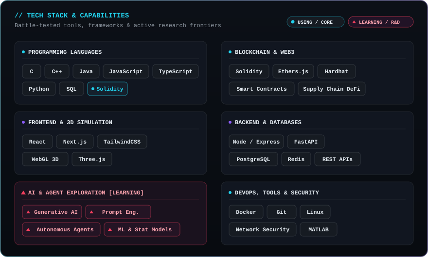
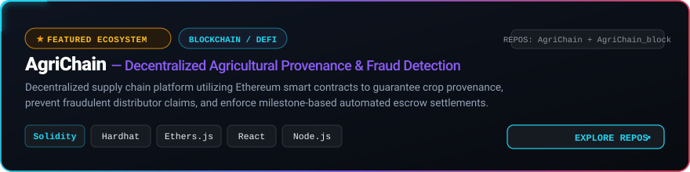
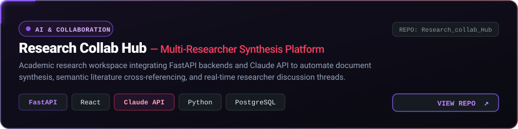
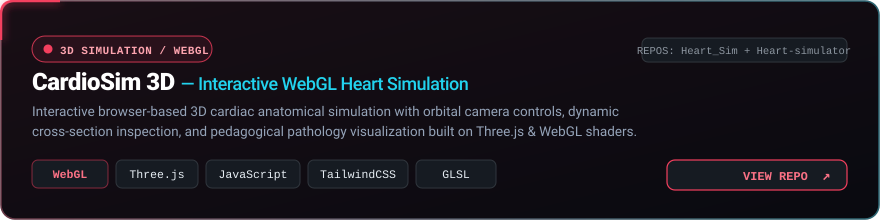
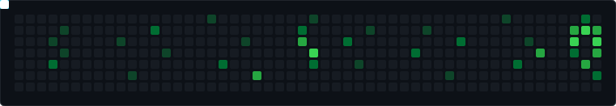

  

  <strong>3rd-year B.E. Computer Science &amp; Engineering &bull; BMSIT&amp;M, Bengaluru</strong> 
  <a href="https://linkedin.com/in/sujal-kumar-kanu">LinkedIn</a> &bull;
  <a href="https://sujalkanu-stack.github.io/portfolio">Portfolio</a> &bull;
  <a href="mailto:sujalguptaa121@gmail.com">Email</a>

  

## About Me

I spend most of my time writing code, studying distributed systems, and building side projects. In college I study computer science fundamentals like data structures, operating systems, and computer networks. Outside coursework, I build full-stack web applications and test smart contracts.

Right now, I am focusing on two areas:
1. Deepening my backend and systems engineering skills in Python, Node.js, and Solidity.
2. Exploring generative AI agents, prompt pipelines, and statistical modelling.

  

  

  

  

## Featured Projects

  

  <em>Why I built it: I saw how middlemen manipulate crop pricing and forge quality certificates in agriculture, so I built an automated escrow smart contract that farmers can verify without trusting an intermediary.</em>

 

  

  <em>Why I built it: To automate dense paper summarization and semantic cross-referencing so researchers can synthesize complex sections faster using Claude API and FastAPI.</em>

 

  

  <em>Why I built it: To give medical students an interactive, 60 FPS real-time 3D anatomical heart simulator in the browser using WebGL shaders and Three.js orbital inspection.</em>

  

## Hackathons

- **ArtPark CodeForge Rhapsody 4.0** (March 2026): Competed at the Indian Institute of Science (IISc), Bengaluru, in a national competition with over 2,796 teams.
- **CODE RED 3.0** (2026): Hackathon organized by E-Cell at BMSIT&M, building timed software prototypes under sprint constraints.

  

## Activity

  <picture>
    <source media="(prefers-color-scheme: dark)" srcset="https://raw.githubusercontent.com/SujalKanu-stack/SujalKanu-stack/output/github-snake-dark.svg">
    <source media="(prefers-color-scheme: light)" srcset="https://raw.githubusercontent.com/SujalKanu-stack/SujalKanu-stack/output/github-snake.svg">
    
  </picture>

 

  
  

 

  

