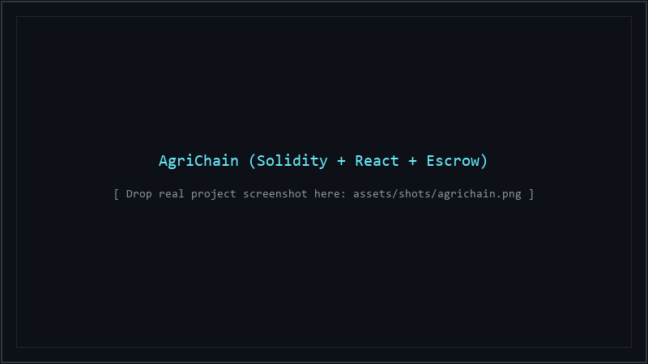
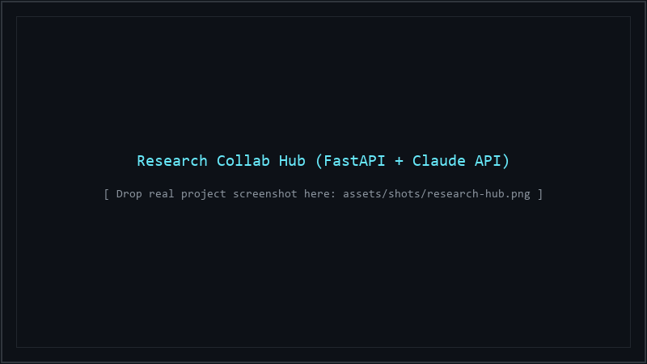
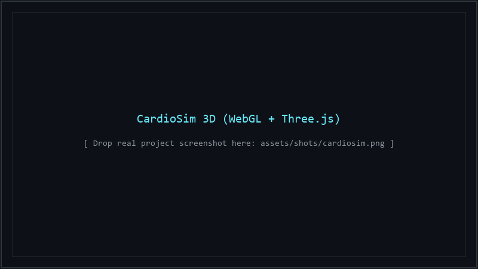
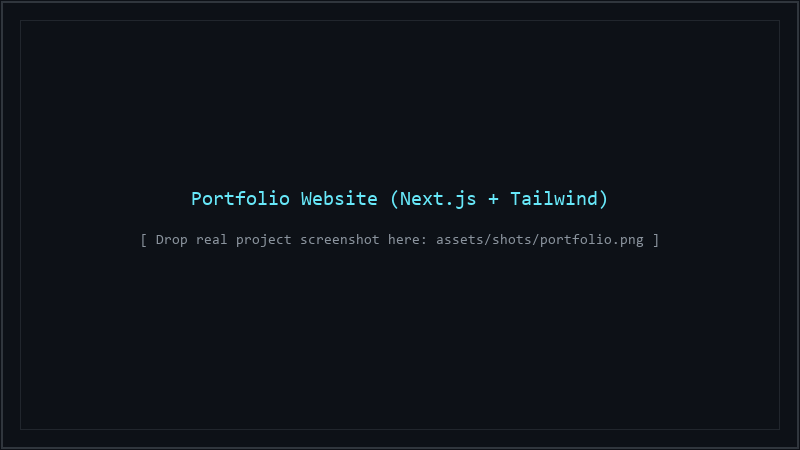

  

  <strong>3rd-year B.E. Computer Science &amp; Engineering &bull; BMSIT&amp;M, Bengaluru</strong> 
  <a href="https://linkedin.com/in/sujal-kumar-kanu">LinkedIn</a> &bull;
  <a href="https://sujalkanu-stack.github.io/portfolio">Portfolio</a> &bull;
  <!-- Replace YOUR_EMAIL_HERE with your email address -->
  <a href="mailto:YOUR_EMAIL_HERE">Email</a>

## About Me

I spend most of my time writing code, studying distributed systems, and building side projects. In college I study computer science fundamentals like data structures, operating systems, and computer networks. Outside coursework, I build full-stack web applications and test smart contracts.

Right now, I am focusing on two areas:
1. Deepening my backend and systems engineering skills in Python, Node.js, and Solidity.
2. Exploring generative AI agents, prompt pipelines, and statistical modelling.

## Projects

### AgriChain
Blockchain supply chain platform with fraud detection.
- **Why I built it:** I saw how middlemen manipulate crop pricing and forge quality certificates in agriculture. I wanted an automated escrow smart contract that farmers can verify without trusting an intermediary.
- **How it works:** Logs provenance steps on Ethereum and holds payments in escrow until delivery checkpoints pass validation.
- **Stack:** Solidity, Hardhat, Ethers.js, React, Node.js
- **Links:** [AgriChain Repo](https://github.com/SujalKanu-stack/AgriChain) &bull; [Contract Repo](https://github.com/SujalKanu-stack/AgriChain_block)

  

---

### Research Collab Hub
Platform for academic research and paper analysis.
- **How it works:** Uses FastAPI on the backend and the Claude API to analyze uploaded research papers, summarize complex sections, and organize discussion threads across team members.
- **Stack:** FastAPI, Python, React, Claude API, PostgreSQL
- **Links:** [Research Collab Hub Repo](https://github.com/SujalKanu-stack/Research_collab_Hub)

  

---

### CardioSim 3D
Interactive 3D heart simulator for medical students and educators.
- **Hardest technical challenge:** Maintaining 60 FPS in WebGL while handling high-polygon heart meshes, camera orbital controls, and real-time hemodynamic flow without browser stutter.
- **Stack:** WebGL, Three.js, JavaScript, TailwindCSS
- **Links:** [CardioSim 3D Repo](https://github.com/SujalKanu-stack/Heart_Sim) &bull; [Alternative Repo](https://github.com/SujalKanu-stack/Heart-simulator)

  

---

### Portfolio Website
Personal developer site.
- **Details:** Built with Next.js and TailwindCSS to document my work and run web experiments.
- **Stack:** Next.js, TypeScript, TailwindCSS
- **Links:** [Portfolio Repo](https://github.com/SujalKanu-stack/portfolio) &bull; [Live Website](https://sujalkanu-stack.github.io/portfolio)

  

## Tech Stack

- **Languages:** C, C++, Java, JavaScript, TypeScript, Python, SQL, Solidity
- **Frontend & 3D:** React, Next.js, TailwindCSS, WebGL, Three.js
- **Backend & Databases:** Node.js, Express, FastAPI, PostgreSQL, Redis
- **Blockchain:** Solidity, Hardhat, Ethers.js
- **DevOps & Environment:** Docker, Git, Linux
- **Other:** IoT sensor telemetry, MATLAB statistical modelling

## Hackathons

- **ArtPark CodeForge Rhapsody 4.0** (March 2026): Competed at the Indian Institute of Science (IISc), Bengaluru, in a national competition with over 2,796 teams.
- **CODE RED 3.0** (2026): Hackathon organized by E-Cell at BMSIT&M, building timed software prototypes under sprint constraints.

## Activity

<picture>
  <source media="(prefers-color-scheme: dark)" srcset="https://raw.githubusercontent.com/SujalKanu-stack/SujalKanu-stack/output/github-snake-dark.svg">
  <source media="(prefers-color-scheme: light)" srcset="https://raw.githubusercontent.com/SujalKanu-stack/SujalKanu-stack/output/github-snake.svg">
  
</picture>

 

<table border="0">
  <tr>
    <td align="center" valign="middle">
      
    </td>
    <td align="center" valign="middle">
      
    </td>
  </tr>
</table>
